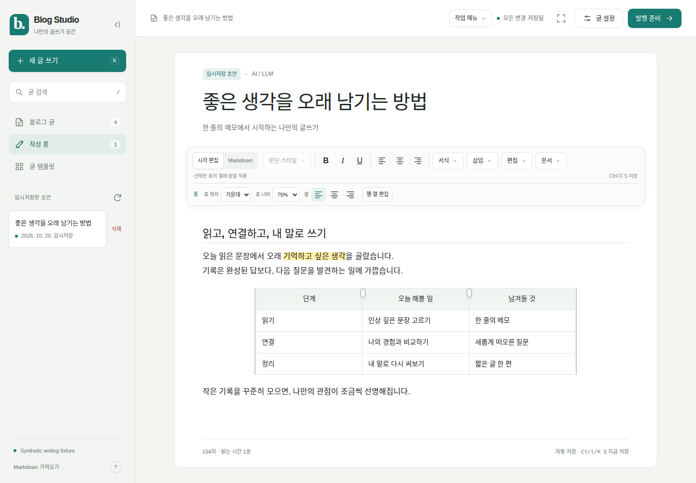
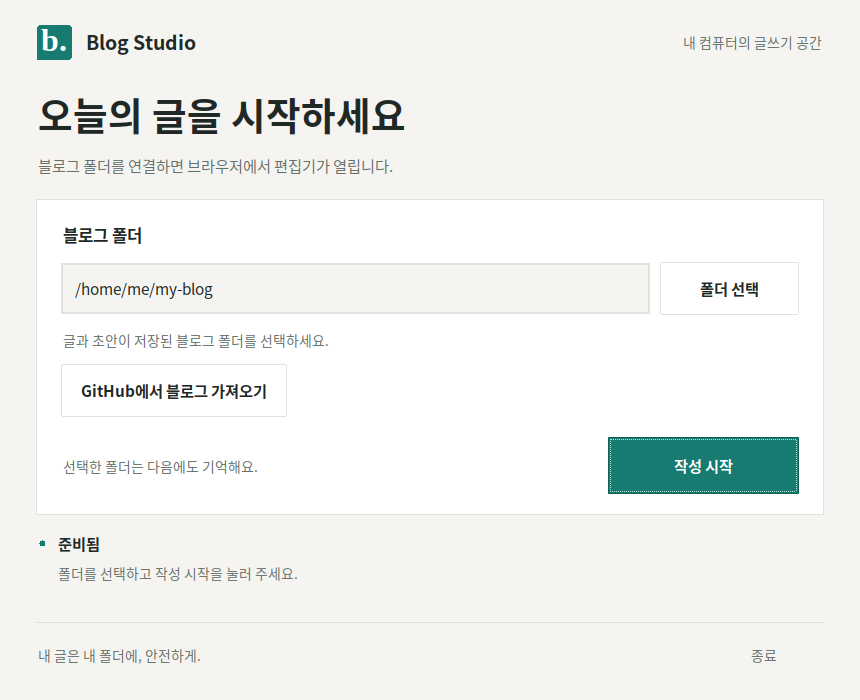

# Blog Studio

[](https://github.com/lococaeco/blog-studio/actions/workflows/desktop.yml)

Jekyll 블로그를 위한 로컬 글쓰기 프로그램입니다. 시각 편집과 Markdown, 문단 정렬,
이미지 편집, 자동 저장, 변경 비교, GitHub 전송과 게시 확인을 지원합니다.
사용자 템플릿, 백업·초안 동기화, 실제 테마 미리보기와 앱 업데이트도 제공합니다.
편집 도구는 기능별 메뉴로 정리되어 있으며, 긴 글을 내려 읽어도 화면 위에서 바로 사용할 수 있습니다.

[](https://github.com/lococaeco/blog-studio/releases/latest/download/BlogStudio.exe)
[](https://github.com/lococaeco/blog-studio/releases/latest/download/BlogStudio-x86_64.AppImage)

**버튼을 누르면 최신 버전의 실행 파일을 바로 내려받습니다.** GitHub 로그인이나
Python 설치 없이 사용할 수 있습니다. [버전별 다운로드와 변경 내역](https://github.com/lococaeco/blog-studio/releases)

**이 저장소는 프로그램을 관리합니다. 글과 초안은 사용자가 선택한 블로그 폴더에 저장합니다.**



글자를 선택하면 서식 도구가, 이미지나 표를 클릭하면 해당 편집 도구가 나타납니다.
이미지 크기와 표의 열 너비는 드래그로 조절하고, 왼쪽 보관함은 화살표로 접어
글쓰기 공간을 넓힐 수 있습니다. [편집 도구 사용법](docs/usage.md)

## 실행 파일로 사용하기

| 운영체제 | 파일 | 실행 방법 |
| --- | --- | --- |
| Windows 10/11, 64비트 | [BlogStudio.exe 다운로드](https://github.com/lococaeco/blog-studio/releases/latest/download/BlogStudio.exe) | 더블클릭 |
| Ubuntu 22.04 이상, x86_64 | [BlogStudio-x86_64.AppImage 다운로드](https://github.com/lococaeco/blog-studio/releases/latest/download/BlogStudio-x86_64.AppImage) | 파일 속성에서 실행 권한을 허용한 뒤 더블클릭 |

1. 위 버튼이나 표에서 운영체제에 맞는 파일을 내려받습니다.
2. 실행 파일을 원하는 앱 폴더로 옮긴 뒤 실행합니다. 별도 설치 과정이 없는
   포터블 앱입니다. 체크섬과 빌드 정보 파일은 검증용이며 실행에 필요하지 않습니다.
3. 실행 창에서 **블로그 폴더**를 선택하고 **작성 시작**을 누릅니다.
   `_config.yml`과 `_posts`가 있는 기존 블로그 폴더를 선택하세요.
   다른 컴퓨터에서는 **GitHub에서 블로그 가져오기**로 새 폴더에 복제할 수 있습니다.
4. 기본 브라우저에서 글을 작성합니다. 다음 실행부터 폴더와 포트를 기억합니다.
5. 종료하기 전 **모든 변경 저장됨**을 확인하고 실행 창에서 종료합니다.

실행 파일에는 Python과 Tk가 포함되어 있습니다. macOS와 ARM용 실행 파일은 제공하지 않습니다.
Windows 실행 파일은 코드 서명이 없어 SmartScreen 경고가 나타날 수 있습니다.

Ubuntu에서 터미널로 실행하려면 다운로드한 폴더에서 다음 명령을 사용합니다.

```sh
chmod +x BlogStudio-x86_64.AppImage
./BlogStudio-x86_64.AppImage
```

AppImage 실행 시 FUSE 오류가 나면 `./BlogStudio-x86_64.AppImage --appimage-extract-and-run`으로
실행하거나, FUSE가 필요 없는 [Linux 단일 실행 파일](https://github.com/lococaeco/blog-studio/releases/latest/download/BlogStudio-linux-x86_64)을
받아 실행 권한을 허용한 뒤 사용하세요.



**GitHub 전송에는 해당 컴퓨터에 설치된 Git과 GitHub 인증이 필요합니다.**
Git 없이도 작성·임시저장·파일 저장은 가능합니다. **GitHub · 업데이트**에서
GitHub CLI를 이용한 브라우저 로그인 또는 개인 액세스 토큰으로 연결합니다.
토큰은 앱 실행 중 메모리에만 보관하며 종료하면 지워집니다.
새 버전은 같은 메뉴에서 확인·다운로드·검증 후 적용하고 앱을 다시 실행할 수 있습니다.

## 블로그와 프로그램의 관계

다음처럼 두 저장소를 나란히 두면 됩니다.

```text
작업 폴더/
├── blog-studio/           # 프로그램 코드, 테스트, 빌드 설정
└── lococaeco.github.io/   # 실제 글과 블로그 설정
    ├── _config.yml
    ├── _posts/
    └── .blog-studio/      # 로컬 초안, 기록, 첨부 이미지
```

프로그램 저장소 자체를 블로그 폴더로 선택하지 마세요. 실행 파일을 바꾸거나
프로그램 코드를 업데이트해도 선택한 블로그의 글·초안은 유지됩니다.
기존 버전과 같은 사용자 설정 경로를 사용하므로 기억한 폴더와 포트도 이어집니다.

다른 컴퓨터에서는 시작 창에서 블로그 저장소를 가져온 뒤 그 폴더를 선택합니다.
**백업·동기화**에서 ZIP으로 초안과 기록을 옮기거나 비공개 GitHub 저장소로
초안을 동기화할 수 있습니다. 블로그의 공개 저장소에는 초안을 전송하지 않습니다.
기존 프로그램이 같은 블로그를 사용 중이라면 먼저 종료하세요.

현재 `lococaeco.github.io`의 Jekyll 구조와 `_data/categories.yml`의
`categories → lv1_category / lv2 → lv2_category / url` 구조를 지원합니다.
다른 Jekyll 테마의 카테고리·대표 이미지·수식·댓글 설정은 호환 여부를 확인해야 합니다.

자세한 작성 방법, 발행 방식, 복구와 제한 사항은 [글쓰기 안내](docs/usage.md)를 보세요.

## 소스 코드로 실행하기

Python **3.10 이상**이 필요합니다. 데스크톱 창에는 Python의 Tk 모듈도 필요합니다.
Ubuntu에서는 소스 실행에 필요한 패키지를 설치합니다.

```sh
sudo apt install python3-venv python3-tk
git clone https://github.com/lococaeco/blog-studio.git
cd blog-studio
./blog-studio.sh --repo ../lococaeco.github.io
```

Windows에서는 이 저장소를 받은 뒤 `blog-studio.cmd`를 더블클릭합니다.
[python.org](https://www.python.org/downloads/)의 Python에 Tcl/Tk를 포함해 설치하세요.

첫 실행에 프로그램 폴더의 `.venv`를 만들고 PyYAML을 설치합니다. 처음 준비할 때만
인터넷이 필요하며, 컴퓨터의 기존 Python 패키지는 변경하지 않습니다.
`--repo`를 생략하면 시작 창에서 블로그 폴더를 선택할 수 있습니다.

창 없이 서버만 실행하려면 대상 블로그를 명시합니다.

```sh
python3 start.py --headless --repo ../lococaeco.github.io --no-browser
```

기본 주소는 `http://127.0.0.1:4310`이며, 포트 충돌 시 다른 주소를 안내합니다.
서버 전용 진입점인 `server.py`는 `--repo`가 필수입니다.
서버는 로컬 컴퓨터에서만 열립니다. GitHub 토큰은 로컬 연결 화면에서만 입력하며
파일·로그·브라우저 저장소에 보관하지 않습니다.

## 개발과 검사

```sh
python3 -m venv .venv
.venv/bin/python -m pip install -r requirements-build.txt
.venv/bin/python -m unittest discover -s tests -p 'test_*.py'
```

Windows에서는 `.venv/bin/python`을 `.venv\Scripts\python.exe`로 바꿉니다.
테스트는 합성 블로그 fixture와 임시 폴더만 사용하며 실제 글에 접근하지 않습니다.

브라우저 검사에는 개발용 Playwright가 추가로 필요합니다.

```sh
.venv/bin/python -m pip install -r requirements-test.txt
.venv/bin/python -m playwright install chromium
.venv/bin/python -m unittest discover -s tests -p 'browser_*.py'
```

설치된 Chrome을 쓰려면 `STUDIO_BROWSER`에 실행 파일 경로를 지정할 수 있습니다.
기존 Markdown 보존, 초안 복구, 충돌 방지, 이미지, 발행 검토, 모바일·키보드
조작을 검사합니다. 변경 원칙과 개발 순서는 [기여 안내](CONTRIBUTING.md)에 정리했습니다.

## 단일 실행 파일 빌드

Windows용은 Windows에서, Ubuntu용은 Ubuntu 22.04에서 빌드합니다.
더 새로운 Linux에서 만든 실행 파일은 오래된 시스템에서 실행되지 않을 수 있습니다.
빌드용 Python 3.12에는 Tk가 필요합니다.

```sh
python -m pip install -r requirements-build.txt
python build_desktop.py
# Ubuntu에서 AppImage도 만들기
python build_appimage.py --binary dist/BlogStudio-linux-x86_64
```

결과는 `dist/`에 생성되며 Git에는 넣지 않습니다. 실행 파일·SHA-256 체크섬·
빌드 정보가 함께 생성됩니다. 로컬 패키지 검사는 운영체제에 맞는 파일로 실행합니다.

```sh
# Windows
python tests/package_smoke.py dist/BlogStudio.exe

# Ubuntu: 화면 없는 환경에서는 xvfb-run -a 사용
xvfb-run -a python tests/package_smoke.py dist/BlogStudio-linux-x86_64
xvfb-run -a python tests/package_smoke.py dist/BlogStudio-x86_64.AppImage
```

GitHub Actions는 Windows와 Ubuntu에서 테스트·빌드·실제 실행 파일 검사를
진행합니다. Linux에서는 브라우저 회귀 검사와 AppImage 실행 검사도 진행합니다.
`v0.1.0` 형식의 버전 태그를 push하면 두 운영체제의 검사가 통과한 파일을
GitHub Releases에 자동 공개합니다. README 버튼은 최신 릴리스를 가리킵니다.
개발 중인 빌드는 [Actions](https://github.com/lococaeco/blog-studio/actions/workflows/desktop.yml)의
Artifacts에서도 받을 수 있습니다. 이 개발용 파일은 로그인이 필요하며 30일간 보관됩니다.

## 구조와 라이선스

- `desktop.py`, `start.py`: 시작 창과 소스 실행 환경
- `server.py`, `runtime.py`: 로컬 API, 저장, Git, 중복 실행 방지
- `studio_features.py`, `theme_preview.py`: 템플릿, 백업·동기화, 링크 카드, Jekyll 미리보기
- `cloud_services.py`, `desktop_cloud.py`, `updater.py`: GitHub 연결·복제·게시 확인과 앱 업데이트
- `static/`: 편집 화면과 오프라인 라이브러리
- `tests/`: 단위·브라우저·패키지 검사와 합성 블로그
- `build_desktop.py`, `build_appimage.py`, `.github/workflows/`: 실행 파일 빌드·검사·릴리스

앱 소스는 [MIT License](LICENSE)로 제공합니다. 포함된 라이브러리의 별도 라이선스는
[Vendor 안내](static/vendor/README.md)를 참고하세요.
이 프로젝트의 분리 이력은 [출처와 이관 기록](docs/provenance.md)에 남겼습니다.
